# PLAN: Super Mario Bros., level by level, on the part

A visual log of the bench learning to play. One schedule of button bytes,
searched on the model and played on the console from power-on, clears a
level more each time it grows; every level here was cleared on the part
with no life lost before the next was planned. On 2026-10-20 the
schedule reached the end of the game: thirty-two levels from power-on
to the princess, one run, no life lost. The drawings are measured
(Mario's path from the model's RAM, the buttons from the schedule the
part played) and the table's verdicts come from the bench's own logs.
No picture of the game is shown: the grabber's frames of a commercial
cartridge stay off the site, and these are drawn from numbers.

Drawn by `tools/plan-log.py` from `docs/plan-log.json` (the record),
`exercise/smb-plan.txt` (the schedule) and a replay of that schedule on
the model; the language this uses is `docs/bench-language.md`.

## The process

The bench cannot react to the game. A decision through the head takes
about a second and a half, a grabbed frame and a line to the bridge, and
Super Mario Bros. moves on ninety polls in that time. So the bench plays
open loop: it is handed a schedule, `AT n hh` lines that say from which
poll the console reads which byte, and the work is in finding the
schedule. Every level went through the same five steps, in this order,
and the next level did not start until the last step passed.

1. **Plan on the model.** `tools/plan.py` drives `nes-console`'s
   `branch` example: the console as a process that saves and loads its
   whole state (`Console::save_state`, a load proven byte-identical to
   the run that never stopped). From the end of the last schedule the
   part cleared, it searches a segment of 30 polls at a time. Each of 20
   moves (run, walk, stop, back, hold A, running jumps starting every 5
   polls at three heights, and in the water A tapped every 10 or 16
   polls) is tried from the segment's saved state and followed by three
   ways on (run, jump now, jump a little later). A move is kept only if
   one of those lives; the kept moves are ranked by the level being done,
   then the area, then how far right Mario got, and the best is
   committed. When every move at a segment dies, the search backs up a
   segment and takes the next best, and gives up the segment before that
   too when one poll has failed four times.
2. **Replay it straight.** The whole schedule, from power-on, through
   `watch` (no saved states, no planner): it must reach the next level's
   intro with the lives it started with. Twice this caught a schedule the
   planner believed (a castle won but not recognised; a flagpole reached
   only in a lookahead the schedule left out).
3. **Count it.** Since the UNO's schedule became a ring (2026-10-18) this
   is a note, not a gate: the head loads 480 entries before the console
   leaves reset and streams the rest as the polls go by.
4. **Play it on the part.** The head runs the script on the bench Pi:
   power, the warm-reset recipe, every `AT` line, and the grabber takes
   frames at chosen polls (kept off the site). Afterwards the run's
   `bridge.log`, the byte the console read at every poll, is checked
   against the script after the final reset: no poll missing, none wrong.
   The level counts as cleared when the console shows the next level's
   intro screen.
5. **Push.** The tools and the record are committed and pushed after a
   check for addresses and pulled documents.

What the search reads off the model, each measured before it was
trusted: `$0770` the mode (1 playing, 2 after a castle's axe), `$000E`
Mario's state (08 under control; 0B hit and 06 dead; 04 the flagpole and
05 the walk to the castle; 02 and 03 a pipe; 07 the game walking him in),
`$006D`:`$0086` his place in the area, `$00B5` the vertical screen (past
1 is a fall), `$075A` the lives, `$0760` the area, `$075C` and `$075F`
the level and the world.

## The levels

<!-- plan-log:table -->
| level | latches | entries | planned in | backtracks | on the part | polls | wrong | what it taught |
|---|---|---|---|---|---|---|---|---|
| 1-1 | 480 to 2190 | 71 | not timed | 4 | `20261017-224132` | 2862 | 0 | A greedy search walks into the first goomba and cannot take it back: backtracking by segment. |
| 1-2 | 3349 to 4870 | 132 | 8.1 min | 1 | `20261017-235518` | 5601 | 0 | Enemy groups need timing (a jump every five latches); a pipe holds Mario longer than the lookahead, and a held segment is no stall. |
| 1-3 | 5683 to 6740 | 172 | not timed | 1 | `20261018-012133` | 7423 | 0 | Keep a move only when a continuation lives (a gentler rule committed Mario to a gap); keep the continuation that found the flagpole. |
| 1-4 | 7470 to 8430 | 197 | 7.4 min | 2 | `20261018-021108` | 9231 | 0 | A castle ends at the axe, not a flagpole: $0770 turns 2, then the next world. |
| 2-1 | 9300 to 10890 | 258 | 13.5 min | 0 | `20261018-023103` | 11622 | 0 | Nothing new. |
| 2-2 | 12081 to 14470 | 370 | 17.4 min | 0 | `20261018-031731` | 15173 | 0 | Swimming (A taps, measured first) and a pipe taken counts above x: past 2-2's exit Mario lands at a smaller x. |
| 2-3 | 15238 to 16730 | 404 | 9.7 min | 0 | `20261018-034339` | 17421 | 0 | Nothing new (the first bench try missed its intro frame: the grabber timed out). |
| 2-4 | 17422 to 18430 | 435 | 7.0 min | 1 | `20261018-040301` | 19241 | 0 | Nothing new: the axe rule held. |
| 3-1 | 19300 to 20930 | 492 | 11.1 min | 0 | `20261018-042415` (streamed) | 21693 | 0 | The first schedule past the head's room: streamed from latch 19990. |
| 3-2 | 21730 to 23280 | 548 | 12.0 min | 0 | `20261018-044744` (streamed) | 24093 | 0 | Nothing new. |
| 3-3 | 24142 to 25190 | 587 | 27.7 min | 0 | `20261018-061315` (streamed) | 25851 | 0 | Beam search: the way on is up, not right, and depth first could not keep that route alive. The first bench try failed on the part, not the plan: the console restarted itself mid-run with a clean poll log (run 20261018-060411). |
| 3-4 | 25906 to 26840 | 618 | 10.3 min | 0 | `20261018-145621` (streamed) | 27683 | 0 | The model has to stop on the poll, not at the end of the frame: a frame that held two polls let the second fall before the planner gave its byte, so the model played that jump a poll late and the first plan failed its straight replay. |
| 4-1 | 27733 to 29240 | 662 | 21.6 min | 0 | `20261018-162219` (streamed) | 30072 | 0 | Nothing new. The first bench run played every poll right, but its intro frame was grabbed after the console was switched off (the script ended ten polls after the grab) and it was run again rather than counted (run 20261018-161233). |
| 4-2 | 30502 to 32660 | 730 | not timed | 0 | `20261018-234630` (streamed) | 33502 | 0 | Five plans and a hand search: the ceiling leads to a warp zone, the beam needs room for height, a jump has to be able to keep A held across a segment, and a warp is a level change to anywhere but the next level. The last tall pipe was crossed by a route searched by hand on the model and spliced onto the beam's stair-top state. |
| 4-3 | 33560 to 34760 | 767 | 53.0 min | 0 | `20261019-015500` (streamed) | 35501 | 0 | Nothing new. The beam crossed the mushroom tops and the lifts on its own: once only six positions were alive, and the best of them had gone back, but it went on. |
| 4-4 | 35530 to 36850 | 796 | not timed | 0 | `20261019-065615` (streamed) | 37793 | 0 | A castle maze sends Mario back unless he stands at the height the game's own table wants as the screen reaches a page. The planner now reads that table out of the game's code, calls the loop-back a death, and gives its height slot to the move whose lookahead stands at the wanted height. That crossed the first check on its own; the second is entered only through a one-tile gap that running right crosses, so that stretch was searched by hand and spliced on. |
| 5-1 | 37820 to 39110 | 845 | 56.3 min | 0 | `20261019-081032` (streamed) | 39951 | 0 | Nothing new: the beam crossed the Bullet Bills and the piranha pipes on its own. |
| 5-2 | 39980 to 41240 | 902 | 74.0 min | 0 | `20261019-094241` (streamed) | 42112 | 0 | Nothing new: the beam stayed above ground past the Hammer Bros and never took the pipe to the water. |
| 5-3 | 42150 to 43200 | 944 | 46.1 min | 0 | `20261019-104805` (streamed) | 44023 | 0 | Nothing new: the beam crossed the treetops, the lifts and the Bullet Bills on its own. |
| 5-4 | 44060 to 45020 | 975 | 42.9 min | 0 | `20261019-115112` (streamed) | 45892 | 0 | Nothing new: the beam crossed World 5's castle, its firebars and Podoboos, on its own. |
| 6-1 | 45930 to 47070 | 1015 | 51.1 min | 0 | `20261019-130306` (streamed) | 47971 | 0 | Nothing new for the planner: the beam crossed Lakitu's night level on its own. On the part the head saw the first two polls after the final reset in one look and logged only the second, so the count starts at 1; the schedule holds 00 there, and every poll from 1 on matches. |
| 6-2 | 48010 to 49510 | 1102 | 78.7 min | 0 | `20261019-144503` (streamed) | 50393 | 0 | Nothing new: the beam stayed above ground past the piranha pipes and never took a pipe down. |
| 6-3 | 50420 to 51410 | 1138 | 49.7 min | 0 | `20261019-160009` (streamed) | 52202 | 0 | Nothing new: the beam crossed the balance lifts and Bullet Bills on its own, down once to eight positions alive. |
| 6-4 | 52230 to 53130 | 1169 | 43.2 min | 0 | `20261019-172628` (streamed) | 54022 | 0 | Nothing new for the planner. The first bench run played every poll right (run 20261019-170655, 54,021 polls, none wrong) but took no frames: the grabber gave up 900 s after it started, and this run's first grab was due later than that. It was run again with the limit raised rather than counted. |
| 7-1 | 54060 to 55200 | 1214 | 54.0 min | 0 | `20261019-191128` (streamed) | 56061 | 0 | Nothing new: the beam crossed the Hammer Bros and Bullet Bill cannons on its own. |
| 7-2 | 56110 to 59320 | 1353 | not timed | 0 | `20261019-224836` (streamed) | 60302 | 0 | A pipe passed stays passed. The water's exit pipe keeps the area number and sets Mario back, so a position through it ranked below one in front of it whose lookahead went in, and the beam stood at the pipe's mouth for twenty segments. Each position now carries the pipes its own path entered. |
| 7-3 | 60330 to 61740 | 1393 | 72.3 min | 0 | `20261020-002836` (streamed) | 62502 | 0 | Nothing new: the beam crossed the bridges under the flying Cheep Cheeps on its own. |
| 7-4 | 62540 to 63800 | 1423 | 59.3 min | 0 | `20261020-015615` (streamed) | 64722 | 0 | Nothing new: the maze checks read from the game in 4-4 carried World 7's six, and the beam passed every one on its own, never sent back. |
| 8-1 | 64740 to 67380 | 1519 | 118.7 min | 0 | `20261020-042403` (streamed) | 68102 | 0 | Nothing new: the longest level in the game, and the beam crossed it on its own in 89 segments, about two hours. |
| 8-2 | 68140 to 69550 | 1573 | 68.7 min | 0 | `20261020-060340` (streamed) | 70413 | 0 | Nothing new: Lakitu, Buzzy Beetles and the stair gaps, and the beam crossed it on its own. |
| 8-3 | 70450 to 71800 | 1622 | 66.7 min | 0 | `20261020-074156` (streamed) | 72573 | 0 | Nothing new: the Hammer Bros on the castle walls, and the beam crossed it on its own. |
| 8-4 | 72620 to 75896 | 1752 | 496.7 min | 0 | `20261020-192022` (streamed) | 77402 | 0 | World 8's maze checks fire whatever Mario does and leave the world under his feet: a loop-back there is a page shift, progress once per check and a death the second time. A pipe whose exit is more than a page behind its entry in the same loaded area is a trap. The climb onto a raised pipe (a hidden block hit, stood on, jumped from) gains nothing to the right, so it was searched by height, six polls at a time, and spliced on. |
<!-- /plan-log:table -->

Each drawing below is one level: Mario's path from the side, the level's
x across and his height up, solid where he is his own and dashed where
the game holds him (a pipe, the walk in, the flagpole), a dot at each
press of A (a jump, or in the water a stroke); under it the buttons over the level's polls, Right and Left
and B held as bars and each press of A a tick.

### 1-1

Planned by the first version, which replayed every candidate from
power-on, about ten seconds each. It walked into the first goomba
greedily and could not undo it; backtracking by segment fixed that, and
the level took four backtracks and about seventy-five minutes.

### 1-2

The first level on saved states: a candidate costs its own latches,
about 0.6 s. The underground's enemy groups needed jumps every five
polls; the exit pipe holds Mario about 75 polls going in and 96 coming
out, longer than the lookahead, so a lookahead now runs on through a held
stretch and a held segment is not a stall.

### 1-3

The treetops. A move that died only in its lookahead used to be kept,
and committed Mario to a gap he was already falling into; now a move
needs a continuation that lives. And the first straight replay stood
Mario alive at the level's end: the planner had seen the flagpole in a
lookahead and left that continuation out of the schedule.

### 1-4

The first castle ends at the axe: `$0770` turns 2 for the bridge and
Toad, and back to 1 at the next world. The planner had reached the axe
and backed out of it, not knowing a win; mode 2 now counts as done. The
first bench try stopped at the start (one poll after the reset and no
more); the retry ran clean, and that start is still not understood.

### 2-1

Nothing new: planned without a backtrack.

### 2-2

The water. Swimming was measured first (steady taps hold Mario near the
surface, every 16 polls sinking slowly, none sinking him to the floor) and
added as moves at the economical rates, each tap costing two entries.
Past the exit pipe Mario lands at a smaller x than the pipe's, in the same
area, so every pipe move scored as going backwards until a pipe taken
counted above x.

### 2-3

Nothing new. The first bench try played correctly but its last frame came
after the console was off (the grabber's own time limit), and was run
again rather than counted.

### 2-4

The second castle: the axe rule held.

### 3-1

The first schedule past the head's room of 480 entries: the head
streamed it from poll 19990 while the game played, and every poll of the
run was in the log and right.

### 3-2

Nothing new, streamed.

### 3-3

The mushroom tops, and the first level depth first could not do. At
about x 950 Mario stood on a low mushroom with a Koopa walking at him and
a tall column ahead whose top no running jump from there could reach:
every move fell or was hit. The way on was up, onto the middle platform
and across from there, which gains no x, so it never ranked first and
had been abandoned segments before the dead end showed. Two smaller
changes did not reach it (a fourth continuation that waits and then
jumps, a longer stall window). What did is a beam: `--beam 4` keeps the
four best positions every segment, distinct by area, x and height, and
expands them all, so the high route survives beside the low one. It cost
about four times as much a segment and planned the level in under half
an hour; the path above climbs where the earlier levels ran.

The first bench run of it failed, and the plan was not why: its poll log
was perfect (every byte as scripted, none missing) while the picture
showed the attract mode's World 1-1 and then the title, the console
having restarted itself partway. It is the third time the console has
misbehaved on its own (two failed starts before), and the cartridge
connector, which makes the lockout chip reset the console when a contact
is poor, is the suspect. The next run, unchanged, cleared the level.

### 3-4

The third castle, and the first plan the straight replay refused for a
fault in the model rather than the search. The planner stops the console
at the end of the poll before each segment, saves it, and hands the
segment's buttons over from there; but the model's `RUN` stopped at the
end of the frame that poll fell in, and around poll 26030 one frame held
two polls. The second had fallen before its byte was given, so the model
played that jump a poll late while the straight replay, and the part,
play it on time: a few pixels of difference, and in the replay Mario
was hit at poll 26101, among the firebars, where the planner had seen
him pass. `RUN` now stops on the poll itself, and an `AT` for a poll
already gone is refused, as the bridge refuses one.
Planned again from the same start, the level went through without a
backtrack and cleared on the part first time.

### 4-1

Lakitu's level, the longest yet: 51 segments without a backtrack, about
twenty minutes. Nothing new for the planner. The first bench run played
every poll right and reached the flagpole, but its last frame was the
capture card's empty screen: the script switched the console off ten
polls after the grab was asked for, and the grab landed after it. It was
run again with the usual margin rather than counted.

### 4-2

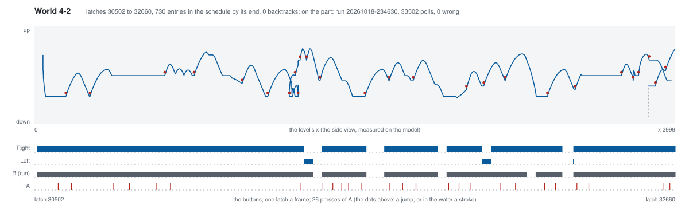

The hardest level so far, and the first the planner did not finish on
its own. Five plans failed, each teaching it something:

1. Depth first stalled under the first piranha pipe: the way on was up
   onto a brick ledge, which gains no x.
2. The beam found the way over the ceiling and ran along it into the
   warp zone, whose pipe would have skipped World 4. Standing on the
   top row now counts as a death (`--no-ceiling`), and so does a warp,
   which is the level changing to anywhere but the next one. (A first
   version of the warp rule read the game's warp flag, `$06D6`, and
   was wrong: it reads 1 on the real route too, beside the last pipe.)
3. The beam stalled at the last tall pipe, pressed against its side:
   ranked by x alone it had dropped the stair tops, the only place the
   jump onto it starts. Some of the beam's room now goes to the highest
   positions Mario reached standing (`--beam-high`).
4. Still stalled, and searching by hand on the model showed why: from
   the stair top, a run of 12 polls and A held for 30 lands on the
   pipe, but only while its piranha is down (a wait of about 36 to 138
   polls), and the jump crosses a segment's end. Every way on in the
   lookahead let go of A at that boundary, so the planner judged it a
   short hop. A fifth way on now keeps A held.
5. The beam then reached the top of the pipe and lost it again.

So that one stretch was searched by hand on the model: from the beam's
own saved state on the stair top, the route above (wait, run, jump,
then a second jump into the exit pipe) was tried over every wait and
two run lengths, and one that lives was spliced on. The planner then
went on from outside the exit pipe to the flagpole in under three
minutes (`--resume` now starts from a saved beam state with the
schedule that reached it). The straight replay from power-on took the
whole schedule to "WORLD 4-3", and so did the part, first time.

### 4-3

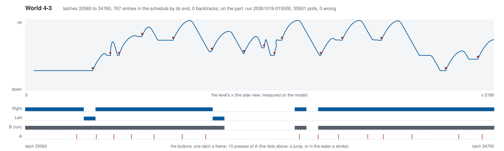

The mushroom tops and the lifts that fall when Mario stands on them.
The beam from 4-2 (four positions, one kept for height) crossed it on
its own: 41 segments, about 53 minutes, nothing searched by hand. Near
the start only six positions were alive and the best of them had gone
back, but the beam went on from there. The straight replay from
power-on took the schedule to "WORLD 4-4", and so did the part, first
time.

### 4-4

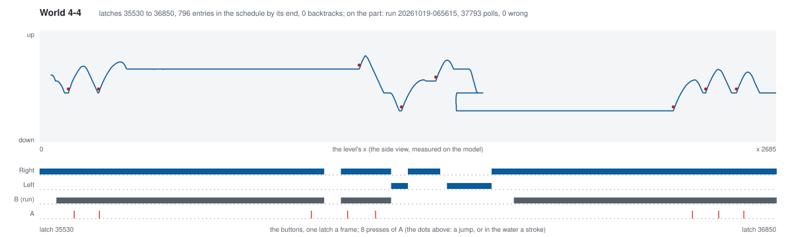

The first maze. On the wrong path the game sends Mario back to the
start of the loop, and it decides at two places: as the screen reaches
page 5 Mario must be standing high, at y `$40`, and as it reaches page
9 he must be on the floor, at y `$B0`. Those numbers are the game's
own, in three tables its code compares against; the planner now reads
them out of the game through those compares.

1. The first plan went nowhere for 500 polls. Sent back, Mario's x
   reads page `$FF` for a moment, and ranked by x that was the
   furthest yet. A jump of more than a page under Mario's own control
   now counts as a death, like a warp. Over the replay of the fifteen
   levels before it, the rule never fires.
2. The beam then ran the lower corridor to the first check and
   stalled there: the corridor is as far right as the upper one. Its
   height slot sat on the opening ledge, the highest place Mario
   stands anywhere.
3. In a maze the height slot now goes to the move whose lookahead
   stands furthest on at the height the next check wants. Ranked at
   the end of its segment, the jump onto the upper band was still in
   the air and lost; ranked by its lookahead, it won, and the beam
   crossed the first check on its own.
4. The second check stalled the beam on the top shelf. The floor's
   corridor is entered only through a gap one tile wide in the middle
   floor, under a hanging brick, and running right goes over it; every
   lookahead runs right.

So that stretch was searched by hand on the model, from the beam's own
saved state on the shelf: drop to the middle floor, walk back left for
80 polls until Mario stops over the gap and falls through, then run.
It was spliced on, and the planner went on from the floor's corridor
to the axe. The straight replay from power-on took the schedule to
"WORLD 5-1", and so did the part, first time.

### 5-1

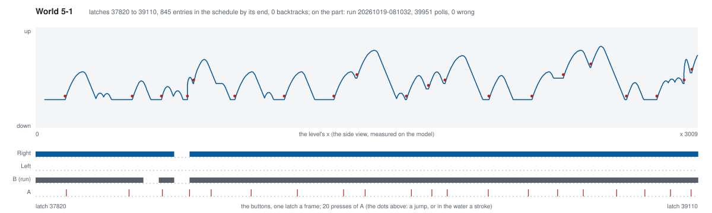

World 5 begins in the open again, with Bullet Bills and piranha pipes.
The beam crossed it on its own: 44 segments, about 56 minutes, nothing
searched by hand. The straight replay from power-on took the schedule
to "WORLD 5-2", and so did the part, first time.

### 5-2

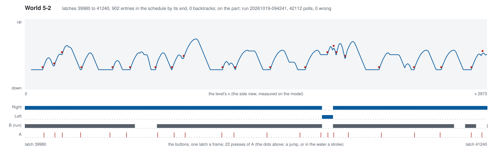

Hammer Bros and Paratroopas above ground, and a pipe down to water
below. The water's moves were offered (`--swim`), but the beam stayed
above ground the whole way and crossed it on its own: 43 segments,
about 74 minutes, nothing searched by hand. The straight replay from
power-on took the schedule to "WORLD 5-3", and so did the part, first
time.

### 5-3

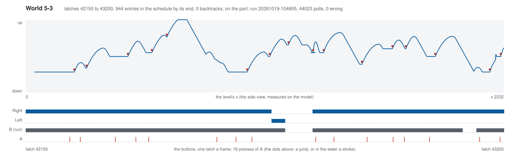

The treetops again, as in 1-3, with Bullet Bills and Paratroopas
added. The beam crossed it on its own: 36 segments, about 46 minutes,
nothing searched by hand. The straight replay from power-on took the
schedule to "WORLD 5-4", and so did the part, first time.

### 5-4

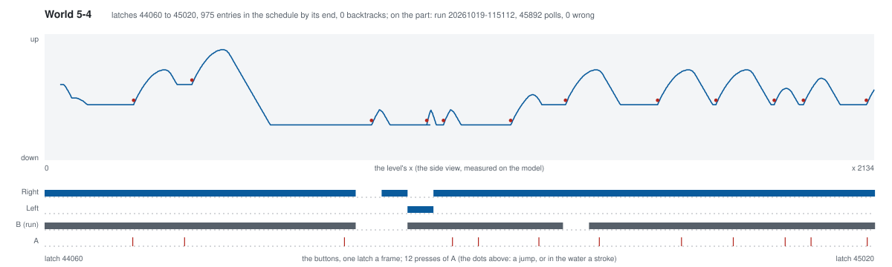

World 5's castle: firebars, Podoboos leaping from the lava, and Bowser
at the bridge. Not a maze, so the game's loop checks play no part. The
beam crossed it on its own: 33 segments, about 43 minutes, nothing
searched by hand. The straight replay from power-on took the schedule
to "WORLD 6-1", and so did the part, first time.

### 6-1

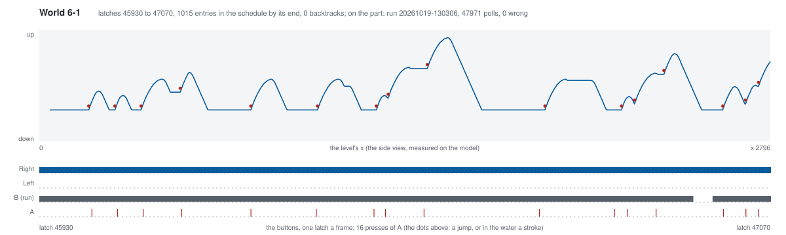

Lakitu again, at night, with the stairs of 4-1. The beam crossed it on
its own: 39 segments, about 51 minutes, nothing searched by hand. The
straight replay from power-on took the schedule to "WORLD 6-2", and so
did the part, first time. Right after the final reset the head saw the
first two polls in one look and logged only the second, so the check
starts at poll 1; the schedule holds 00 until poll 200, and every
logged poll matches.

### 6-2

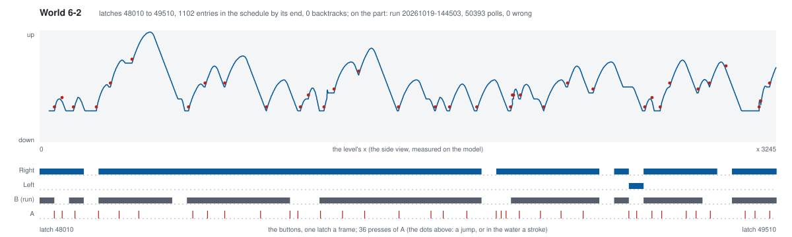

The longest level yet: a night of piranha pipes, with water and a
bonus room below some of them. The water's moves were offered
(`--swim`), but the beam stayed above ground and crossed it on its
own: 51 segments, about 79 minutes, nothing searched by hand. The
straight replay from power-on took the schedule to "WORLD 6-3", and so
did the part, first time.

### 6-3

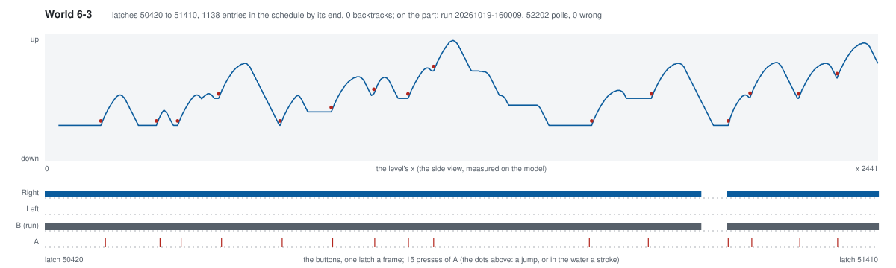

Grey treetops at night, balance lifts and Bullet Bills. Once only
eight positions were alive at a segment's end, but the beam went on
from there and crossed it on its own: 34 segments, about 50 minutes,
nothing searched by hand. The straight replay from power-on took the
schedule to "WORLD 6-4", and so did the part, first time.

### 6-4

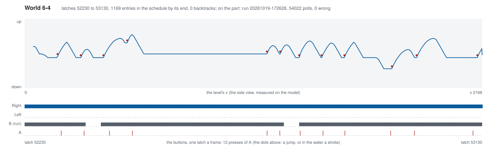

World 6's castle, not a maze. The beam crossed it on its own: 31
segments, about 43 minutes, nothing searched by hand. The first bench
run played every poll right but took no frames: the grabber gives up a
set time after it starts, and with the schedule this long the first
grab was due after that. It was run again with the limit raised, and
reached "WORLD 7-1".

### 7-1

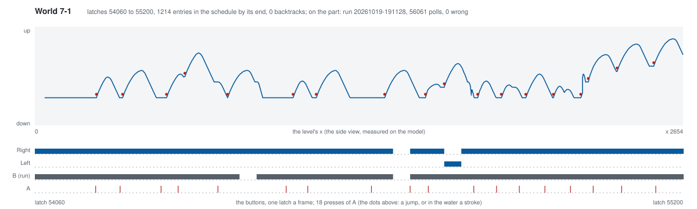

Hammer Bros on the ledges and Bullet Bill cannons. The beam crossed it
on its own: 39 segments, about 54 minutes, nothing searched by hand.
The straight replay from power-on took the schedule to "WORLD 7-2",
and so did the part, first time.

### 7-2

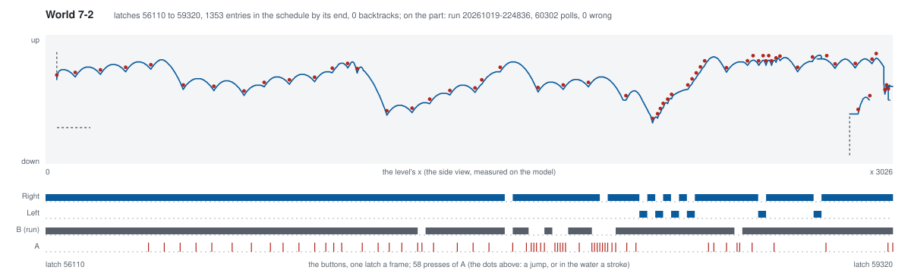

The water again, as in 2-2, with Bloopers and Cheep Cheeps. The beam
swam it on its own, about 45 dots a segment, and then stood at the
exit pipe's mouth for twenty segments without going in.

The pipe is why. Going through it keeps the area number (2-2's exit
did not) and sets Mario back 138 dots, and the planner counted a pipe
above x only while it was inside a lookahead. So a position already
through the pipe ranked below any position in front of it whose
lookahead went in, and the beam kept choosing the mouth. Each position
now carries the pipes its own path has entered, and that count ranks
with its area: a pipe passed stays passed. Resumed with that rule from
the beam's own saved state in front of the pipe, it was through in
four segments and at the flag in eight; nothing was searched by hand.
The straight replay from power-on took the schedule to "WORLD 7-3",
and so did the part, first time.

### 7-3

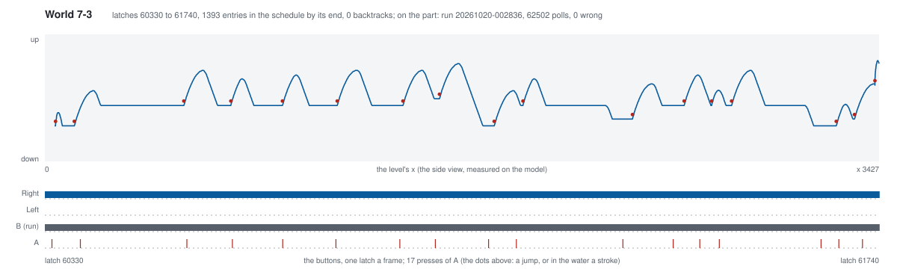

The bridges of 2-3 again, under flying Cheep Cheeps, with Koopa
Paratroopas between them. The beam crossed it on its own: 48 segments,
about 72 minutes, nothing searched by hand. The straight replay from
power-on took the schedule to "WORLD 7-4", and so did the part, first
time.

### 7-4

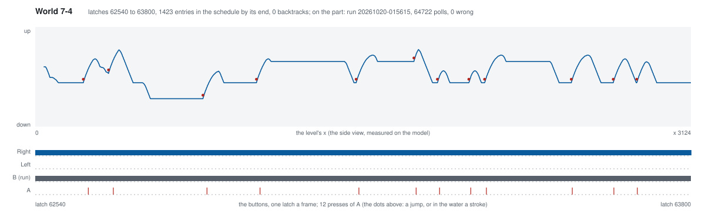

World 7's castle, the second maze, and the longer one: six places
where the wrong path sends Mario back, against 4-4's two. The planner
read all six out of the game the way it read 4-4's, and the beam
passed every one on its own: never sent back, 43 segments, about an
hour, nothing searched by hand. The straight replay from power-on took
the schedule past the axe to "WORLD 8-1", and so did the part, first
time.

### 8-1

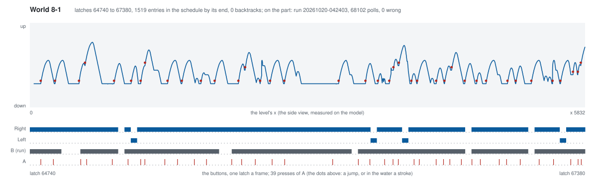

The longest level in the game, about six thousand dots of Koopas,
Buzzy Beetles and gaps, with the timer short. The beam crossed it on
its own: 89 segments, about two hours, nothing searched by hand. The
straight replay from power-on took the schedule to "WORLD 8-2", and so
did the part, first time.

### 8-2

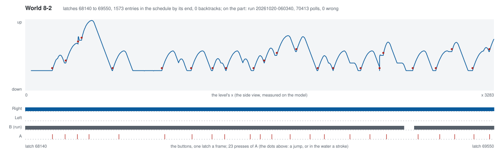

Lakitu over the stairs, Buzzy Beetles and Bullet Bills below, and
gaps between the stair blocks. The beam crossed it on its own: 48
segments, about 69 minutes, nothing searched by hand. The straight
replay from power-on took the schedule to "WORLD 8-3", and so did the
part, first time.

### 8-3

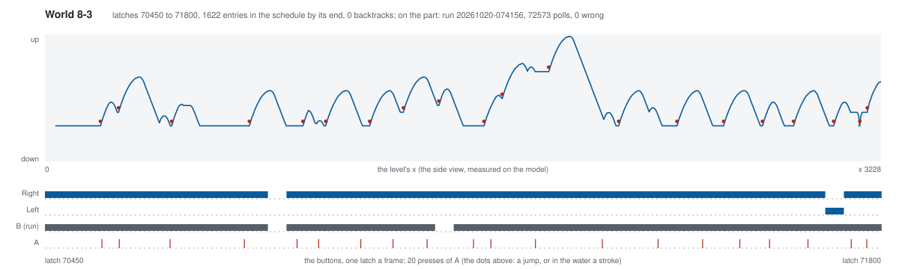

Castle walls across the level, each with Hammer Bros on it, and
Bullet Bills between. The beam crossed it on its own: 46 segments,
about 67 minutes, nothing searched by hand. The straight replay from
power-on took the schedule to "WORLD 8-4", and so did the part, first
time.

### 8-4

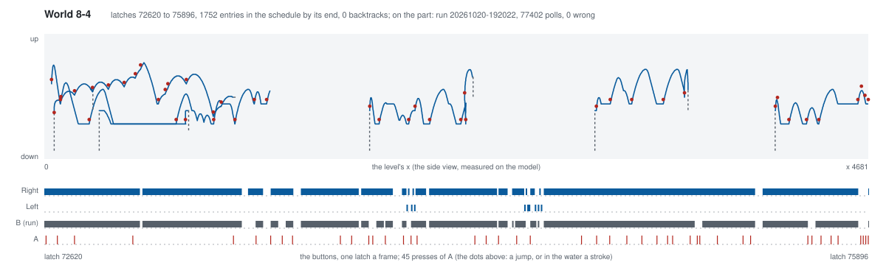

The last castle, and the one level the beam could not cross alone.
World 8's three maze checks want a height Mario never has, so each
fires whatever he does as the screen reaches its page: the game sends
the page numbers back four pages but leaves the world under his feet,
and he walks on in it, into the pipe past the check's column. The maze
rule written for 4-4 called that loop-back a death, and the beam
stalled at the first check for two runs. Read in the game's code and
measured on the model, the loop-back became a page shift in such a
world, counted as progress once per check. Counted every time, the
beam circled the second section four times, because its exit is a
raised pipe that needs a hidden block hit, stood on and jumped from,
three moves that gain nothing to the right. That climb, and the jump
onto the water pipe after the lava, were found by
`tools/plan-climb.py`, a six-poll beam ranked by height, and spliced
into the beam's saved state as 4-4's gap was. Two more rules came out
of the wrong pipes: a pipe whose exit is more than a page behind its
entry in the same area is a trap (every wrong pipe here leads to page
1), and the area is the one loaded, not the pointer the pipe already
carries. Six planner runs, 97 segments on the final path, about eight
hours of planner time. The straight replay from power-on reached the
axe with the lives it started with, and so did the part, first time:
Bowser fell, the text came.

## The whole game

Thirty-two levels, one schedule of 1,752 entries, played from power-on
on the part in run `20261020-192022`: 77,402 polls checked against the
script after the final reset, none wrong, none missing, no life lost
from the title screen to the princess. The planner that found it is
the sum of what the levels taught, in this order: back up by segment
when a move dies (1-1); time an enemy group by lookahead, and a held
Mario is no stall (1-2); keep a move only when a way on lives (1-3);
swim by tapping A, and a pipe taken counts above x (2-2); search as a
beam when the way on is up (3-3); give the beam room for height, keep
A held across a segment, call a warp a death (4-2); read the castle
mazes' checks out of the game's code (4-4); a pipe passed stays passed
(7-2); and in World 8's castle a loop-back is a page shift, once per
check, a pipe that sends Mario back is a trap, and a climb is searched
by height and spliced on (8-4). Everything from 4-4 to 8-3 the beam
crossed on its own. Two stretches in thirty-two levels were searched
by hand on the model and spliced in: 4-4's one-tile gap and 8-4's two
climbs; the drawings mark neither apart, because the part played them
the same way, open loop, from one script.
