# PLAN: Super Mario Bros., level by level, on the part

A visual log of the bench learning to play. One schedule of button bytes,
searched on the model and played on the console from power-on, clears a
level more each time it grows; every level here was cleared on the part
with no life lost before the next was planned. The drawings are measured
(Mario's path from the model's RAM, the buttons from the schedule the
part played) and the table's verdicts come from the bench's own logs.
No picture of the game is shown: the grabber's frames of a commercial
cartridge stay off the site, and these are drawn from numbers.

Drawn by `tools/plan-log.py` from `docs/plan-log.json` (the record),
`exercise/smb-plan.txt` (the schedule) and a replay of that schedule on
the model; the language this uses is `docs/bench-language.md`.

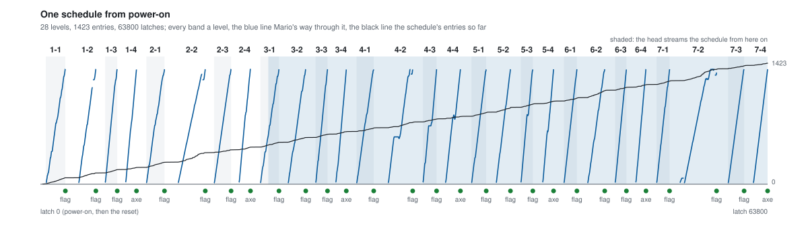

## The process

The bench cannot react to the game. A decision through the head takes
about a second and a half, a grabbed frame and a line to the bridge, and
Super Mario Bros. moves on ninety polls in that time. So the bench plays
open loop: it is handed a schedule, `AT n hh` lines that say from which
poll the console reads which byte, and the work is in finding the
schedule. Every level went through the same five steps, in this order,
and the next level did not start until the last step passed.

1. **Plan on the model.** `tools/plan.py` drives `nes-console`'s
   `branch` example: the console as a process that saves and loads its
   whole state (`Console::save_state`, a load proven byte-identical to
   the run that never stopped). From the end of the last schedule the
   part cleared, it searches a segment of 30 polls at a time. Each of 20
   moves (run, walk, stop, back, hold A, running jumps starting every 5
   polls at three heights, and in the water A tapped every 10 or 16
   polls) is tried from the segment's saved state and followed by three
   ways on (run, jump now, jump a little later). A move is kept only if
   one of those lives; the kept moves are ranked by the level being done,
   then the area, then how far right Mario got, and the best is
   committed. When every move at a segment dies, the search backs up a
   segment and takes the next best, and gives up the segment before that
   too when one poll has failed four times.
2. **Replay it straight.** The whole schedule, from power-on, through
   `watch` (no saved states, no planner): it must reach the next level's
   intro with the lives it started with. Twice this caught a schedule the
   planner believed (a castle won but not recognised; a flagpole reached
   only in a lookahead the schedule left out).
3. **Count it.** Since the UNO's schedule became a ring (2026-10-18) this
   is a note, not a gate: the head loads 480 entries before the console
   leaves reset and streams the rest as the polls go by.
4. **Play it on the part.** The head runs the script on the bench Pi:
   power, the warm-reset recipe, every `AT` line, and the grabber takes
   frames at chosen polls (kept off the site). Afterwards the run's
   `bridge.log`, the byte the console read at every poll, is checked
   against the script after the final reset: no poll missing, none wrong.
   The level counts as cleared when the console shows the next level's
   intro screen.
5. **Push.** The tools and the record are committed and pushed after a
   check for addresses and pulled documents.

What the search reads off the model, each measured before it was
trusted: `$0770` the mode (1 playing, 2 after a castle's axe), `$000E`
Mario's state (08 under control; 0B hit and 06 dead; 04 the flagpole and
05 the walk to the castle; 02 and 03 a pipe; 07 the game walking him in),
`$006D`:`$0086` his place in the area, `$00B5` the vertical screen (past
1 is a fall), `$075A` the lives, `$0760` the area, `$075C` and `$075F`
the level and the world.

## The levels

<!-- plan-log:table -->
| level | latches | entries | planned in | backtracks | on the part | polls | wrong | what it taught |
|---|---|---|---|---|---|---|---|---|
| 1-1 | 480 to 2190 | 71 | not timed | 4 | `20261017-224132` | 2862 | 0 | A greedy search walks into the first goomba and cannot take it back: backtracking by segment. |
| 1-2 | 3349 to 4870 | 132 | 8.1 min | 1 | `20261017-235518` | 5601 | 0 | Enemy groups need timing (a jump every five latches); a pipe holds Mario longer than the lookahead, and a held segment is no stall. |
| 1-3 | 5683 to 6740 | 172 | not timed | 1 | `20261018-012133` | 7423 | 0 | Keep a move only when a continuation lives (a gentler rule committed Mario to a gap); keep the continuation that found the flagpole. |
| 1-4 | 7470 to 8430 | 197 | 7.4 min | 2 | `20261018-021108` | 9231 | 0 | A castle ends at the axe, not a flagpole: $0770 turns 2, then the next world. |
| 2-1 | 9300 to 10890 | 258 | 13.5 min | 0 | `20261018-023103` | 11622 | 0 | Nothing new. |
| 2-2 | 12081 to 14470 | 370 | 17.4 min | 0 | `20261018-031731` | 15173 | 0 | Swimming (A taps, measured first) and a pipe taken counts above x: past 2-2's exit Mario lands at a smaller x. |
| 2-3 | 15238 to 16730 | 404 | 9.7 min | 0 | `20261018-034339` | 17421 | 0 | Nothing new (the first bench try missed its intro frame: the grabber timed out). |
| 2-4 | 17422 to 18430 | 435 | 7.0 min | 1 | `20261018-040301` | 19241 | 0 | Nothing new: the axe rule held. |
| 3-1 | 19300 to 20930 | 492 | 11.1 min | 0 | `20261018-042415` (streamed) | 21693 | 0 | The first schedule past the head's room: streamed from latch 19990. |
| 3-2 | 21730 to 23280 | 548 | 12.0 min | 0 | `20261018-044744` (streamed) | 24093 | 0 | Nothing new. |
| 3-3 | 24142 to 25190 | 587 | 27.7 min | 0 | `20261018-061315` (streamed) | 25851 | 0 | Beam search: the way on is up, not right, and depth first could not keep that route alive. The first bench try failed on the part, not the plan: the console restarted itself mid-run with a clean poll log (run 20261018-060411). |
| 3-4 | 25906 to 26840 | 618 | 10.3 min | 0 | `20261018-145621` (streamed) | 27683 | 0 | The model has to stop on the poll, not at the end of the frame: a frame that held two polls let the second fall before the planner gave its byte, so the model played that jump a poll late and the first plan failed its straight replay. |
| 4-1 | 27733 to 29240 | 662 | 21.6 min | 0 | `20261018-162219` (streamed) | 30072 | 0 | Nothing new. The first bench run played every poll right, but its intro frame was grabbed after the console was switched off (the script ended ten polls after the grab) and it was run again rather than counted (run 20261018-161233). |
<!-- /plan-log:table -->

Each drawing below is one level: Mario's path from the side, the level's
x across and his height up, solid where he is his own and dashed where
the game holds him (a pipe, the walk in, the flagpole), a dot at each
press of A (a jump, or in the water a stroke); under it the buttons over the level's polls, Right and Left
and B held as bars and each press of A a tick.

### 1-1

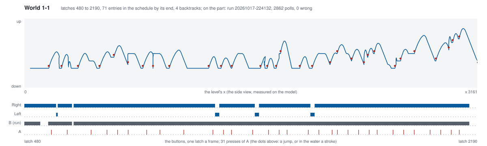

Planned by the first version, which replayed every candidate from
power-on, about ten seconds each. It walked into the first goomba
greedily and could not undo it; backtracking by segment fixed that, and
the level took four backtracks and about seventy-five minutes.

### 1-2

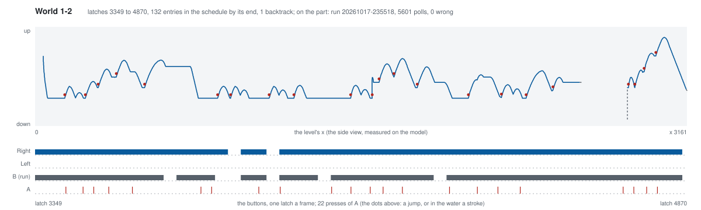

The first level on saved states: a candidate costs its own latches,
about 0.6 s. The underground's enemy groups needed jumps every five
polls; the exit pipe holds Mario about 75 polls going in and 96 coming
out, longer than the lookahead, so a lookahead now runs on through a held
stretch and a held segment is not a stall.

### 1-3

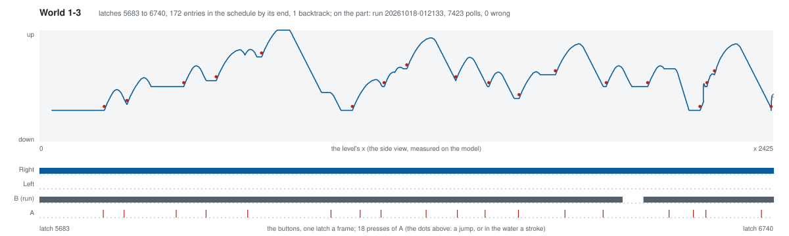

The treetops. A move that died only in its lookahead used to be kept,
and committed Mario to a gap he was already falling into; now a move
needs a continuation that lives. And the first straight replay stood
Mario alive at the level's end: the planner had seen the flagpole in a
lookahead and left that continuation out of the schedule.

### 1-4

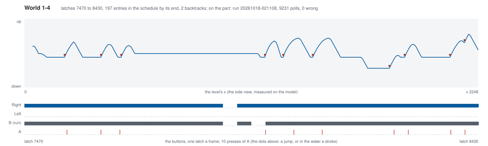

The first castle ends at the axe: `$0770` turns 2 for the bridge and
Toad, and back to 1 at the next world. The planner had reached the axe
and backed out of it, not knowing a win; mode 2 now counts as done. The
first bench try stopped at the start (one poll after the reset and no
more); the retry ran clean, and that start is still not understood.

### 2-1

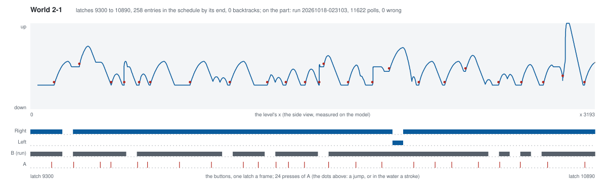

Nothing new: planned without a backtrack.

### 2-2

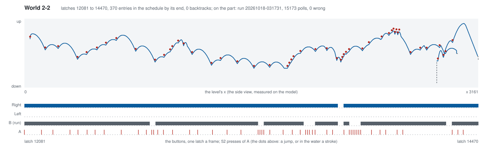

The water. Swimming was measured first (steady taps hold Mario near the
surface, every 16 polls sinking slowly, none sinking him to the floor) and
added as moves at the economical rates, each tap costing two entries.
Past the exit pipe Mario lands at a smaller x than the pipe's, in the same
area, so every pipe move scored as going backwards until a pipe taken
counted above x.

### 2-3

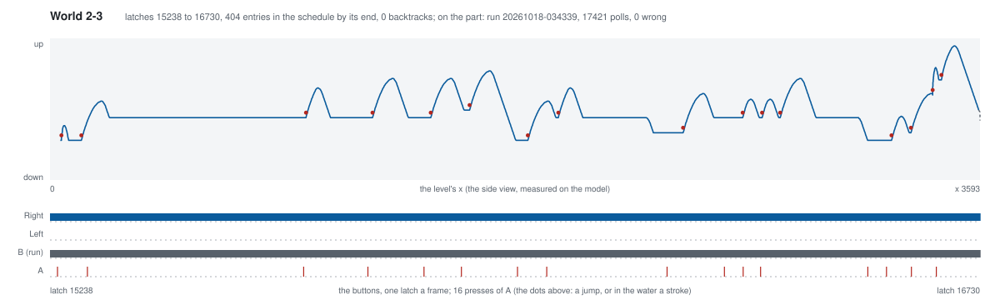

Nothing new. The first bench try played correctly but its last frame came
after the console was off (the grabber's own time limit), and was run
again rather than counted.

### 2-4

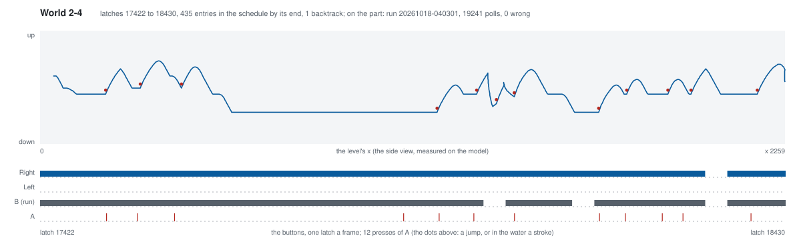

The second castle: the axe rule held.

### 3-1

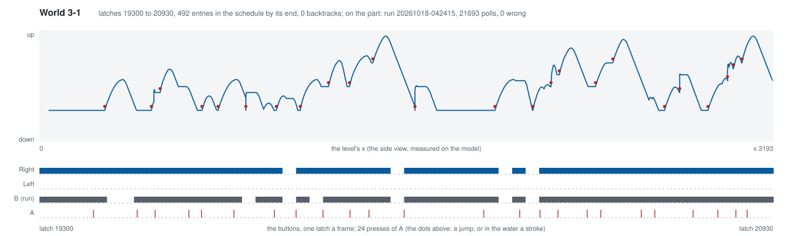

The first schedule past the head's room of 480 entries: the head
streamed it from poll 19990 while the game played, and every poll of the
run was in the log and right.

### 3-2

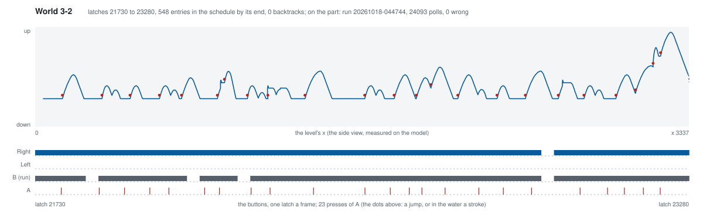

Nothing new, streamed.

### 3-3

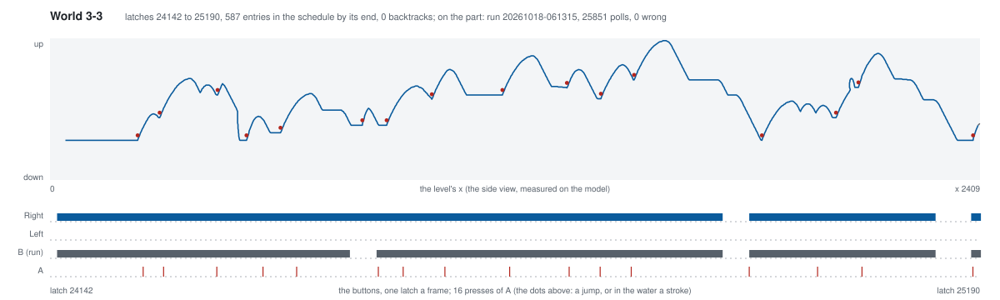

The mushroom tops, and the first level depth first could not do. At
about x 950 Mario stood on a low mushroom with a Koopa walking at him and
a tall column ahead whose top no running jump from there could reach:
every move fell or was hit. The way on was up, onto the middle platform
and across from there, which gains no x, so it never ranked first and
had been abandoned segments before the dead end showed. Two smaller
changes did not reach it (a fourth continuation that waits and then
jumps, a longer stall window). What did is a beam: `--beam 4` keeps the
four best positions every segment, distinct by area, x and height, and
expands them all, so the high route survives beside the low one. It cost
about four times as much a segment and planned the level in under half
an hour; the path above climbs where the earlier levels ran.

The first bench run of it failed, and the plan was not why: its poll log
was perfect (every byte as scripted, none missing) while the picture
showed the attract mode's World 1-1 and then the title, the console
having restarted itself partway. It is the third time the console has
misbehaved on its own (two failed starts before), and the cartridge
connector, which makes the lockout chip reset the console when a contact
is poor, is the suspect. The next run, unchanged, cleared the level.

### 3-4

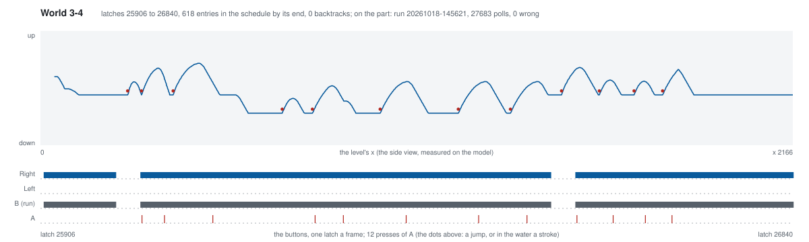

The third castle, and the first plan the straight replay refused for a
fault in the model rather than the search. The planner stops the console
at the end of the poll before each segment, saves it, and hands the
segment's buttons over from there; but the model's `RUN` stopped at the
end of the frame that poll fell in, and around poll 26030 one frame held
two polls. The second had fallen before its byte was given, so the model
played that jump a poll late while the straight replay, and the part,
play it on time: a few pixels of difference, and in the replay Mario
was hit at poll 26101, among the firebars, where the planner had seen
him pass. `RUN` now stops on the poll itself, and an `AT` for a poll
already gone is refused, as the bridge refuses one.
Planned again from the same start, the level went through without a
backtrack and cleared on the part first time.

### 4-1

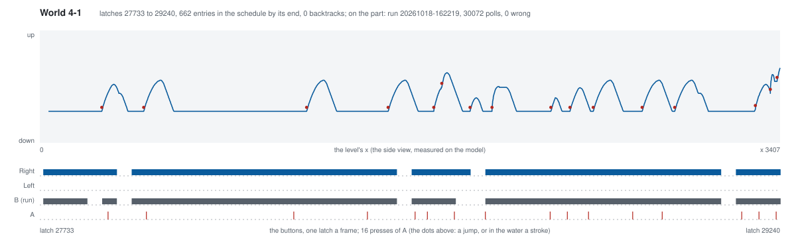

Lakitu's level, the longest yet: 51 segments without a backtrack, about
twenty minutes. Nothing new for the planner. The first bench run played
every poll right and reached the flagpole, but its last frame was the
capture card's empty screen: the script switched the console off ten
polls after the grab was asked for, and the grab landed after it. It was
run again with the usual margin rather than counted.
