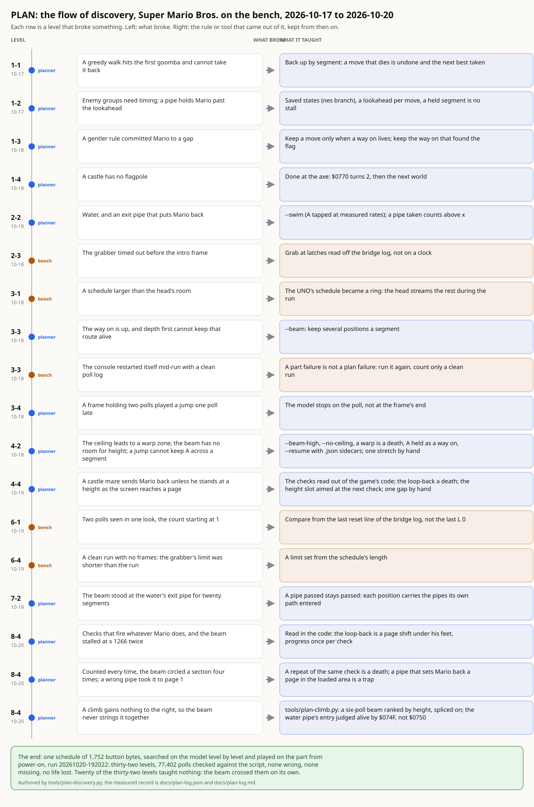

# PLAN, the first game: a retrospective

Written 2026-10-20, the evening the part played Super Mario Bros. from
power-on to the princess on one schedule. What we set out to do, how it
went, what it cost, what we would change, and what comes next. The
measured record is `docs/plan-log.md` and `docs/plan-log.json`; this
is the reading of it. The flow of discovery is drawn in
`docs/plan-discovery.svg` (by `tools/plan-discovery.py`, authored).

## The thinking

The bench cannot react to the game. A decision through the head costs
about a second and a half, and the game moves ninety polls in that
time, so closed-loop play was never on the table. What the bench has
instead is a model: `nes-console`, the switch-level 2A03 and 2C02 under
a behavioural shell, exact enough that the same button bytes at the
same polls produce the same game on the part. That turns playing into
searching. Find a schedule on the model, where a position can be saved
and a move tried from it a thousand times, and the part only has to
play it back.

The bet was that the model is exact at the poll, not just on average:
that a jump planned one frame late on the model is one frame late on
the console too. Thirty-two levels of poll-for-poll agreement, 77,402
polls in the last run with none wrong, is the measurement of that bet.
Nothing else here would have worked without it.

## The approach

One schedule, grown a level at a time, with a gate before each
extension. Every level went through five steps in order and the next
level did not start until the fifth passed: plan on the model from the
end of the last cleared schedule; replay the whole thing from power-on
with no planner and no saved states; count it against the head's room;
play it on the part with the grabber taking frames at chosen polls; and
push. The gate that mattered most was the straight replay: twice it
caught a schedule the planner believed, a castle won but not
recognised, and a flagpole reached only inside a lookahead the schedule
left out.

The planner itself stayed small on purpose, a few hundred lines and
eight words, and every rule in it was added when a level failed without
it. That order is the point: a rule written in advance would have been
a guess about the game, and the ones that were written on demand are
each tied to a measured failure that a reader can find in the log. The
beam, the height slots, the maze checks read from the ROM, the pipe
count carried on the path, the page shift once per check: each has a
level's name on it.

The bench side had its own discipline. A run counted only when its
bridge log, the byte the console read at every poll, matched the script
after the final reset with no poll missing. A part failure (the console
restarting itself mid-run, the grabber timing out, a frame taken after
power-off) was run again and never counted, and the lesson of each was
written down where the next person would trip on it.

## What it cost

| | |
|---|---|
| Calendar | 2026-10-17 evening to 2026-10-20 evening, four days |
| Planner time | about 26 hours over the levels that were timed, five untimed |
| Levels the beam crossed alone | 20 of 32, every one from 5-1 to 8-3 |
| Levels that taught a rule | 11 |
| Stretches searched by hand and spliced | 3 (4-2's last tall pipe, 4-4's one-tile gap, 8-4's two climbs) |
| Bench runs counted | 32, one per level |
| Bench runs repeated for a part or grabber failure | 4 (2-3, 3-3, 4-1, 6-4) |
| Schedule | 1,752 entries, played from power-on in 77,402 polls |

The planner's time went where the game is hard: 8-1, the longest
level, took two hours of beam; 8-4 took six planner runs and about
eight hours, more than the rest of World 8 together.

## The challenges

**4-2 was the first wall.** Five plans. The beam found the warp zone
over the ceiling (a death, by the rule written that day), then had no
room for height, then could not hold a jump across a segment boundary,
and finally stalled at the last tall pipe, which was crossed by hand on
the model and spliced on. Four of the planner's eight words date from
this level.

**The castle mazes.** 4-4 sends Mario back unless he stands at a height
the game's own table wants as the screen reaches a page. The planner
reads that table out of the ROM (the code's compares of the world, the
page and Mario's y), calls the loop-back a death, and aims its height
slot at the next check. That carried 7-4's six checks without a single
send-back.

**7-2, the stall at the pipe's mouth.** The water's exit pipe keeps the
area number and sets Mario back, so a position through it ranked below
one in front of it whose lookahead went in, and the beam stood at the
mouth for twenty segments. The fix, a pipe passed stays passed, is the
kind of rule that looks obvious once written and took a measurement to
see.

**8-4, the last castle, was the hard one.** Its three checks want a
height Mario never has, so each fires whatever he does, and 4-4's rule
called the result a death: the beam stalled at x 1266 twice. Reading
the game's code showed the loop-back leaves the block buffer and the
picture under Mario, who walks on in a world shifted four pages; the
planner learned to count that as progress. Counted every time, the beam
circled a section four times, because the section's exit is a raised
pipe that needs a hidden block hit, stood on and jumped from, three
moves that gain nothing to the right. A second tool, a six-poll beam
ranked by height, found that climb and the jump onto the water pipe;
both were spliced on. Then the water pipe's entry was judged a trap,
because the rule compared the area pointer, which already holds the
destination when a pipe is entered; the loaded area lives at a
different address. Each of these was found the same way: a probe of
the model's RAM per poll beside the disassembly, and a rule only once
the failure was understood.

**The instruments.** The 4-1 run was clean but its frame was grabbed
after power-off; 6-4's grabber gave up before the run's first grab was
due; 6-1's head saw two polls in one look and the count started at 1,
which moved the check's cut to the last reset line. And on the last
day the workstation's disk filled to the brim with beam states from
the hand searches, which no planner noticed until a save failed. None
of these were plan failures, and each got a line in the log so it
stays found.

## What we would change

- **Let the planner call for the climb.** The three hand-searched
  stretches were all the same shape: a stall where the way on is up or
  back, not right. The planner can detect its own stall (it already
  does, to back out) and hand the stretch to the height-ranked search
  itself, from its own saved state, instead of a person doing it.
- **Read the exits out of the ROM too.** The maze checks are read from
  the game's code; the pipe pointers, the hidden blocks and the loop
  commands are in the same tables. A planner that knows where a
  section's exit is would not need to be told that circling is not
  progress.
- **Judge on the model's own facts.** Two 8-4 rules went wrong first
  on a convenient address (the level's area number, the area pointer)
  before the right one (the loaded area). The watch list should name
  what each address is for, and a rule should be measured against the
  state it claims to read before it is trusted.
- **Keep the clock.** Five levels have no planner time because the log
  did not write one; 8-4's is an estimate from its segment count. The
  planner should stamp its own log.
- **Checkpoint the replay.** The straight replay from power-on takes
  eleven minutes now and grows with the schedule. A saved state at
  each level's intro, proven equal to the straight run once, would make
  the gate seconds without weakening it.
- **Clean up after the search.** Beam states are a megabyte each and a
  hand search keeps thousands. The climb tool now deletes what it does
  not keep; the planner should too, and a search should refuse to start
  on a disk below a margin.
- **Pick the grab polls from the trace.** The frames that prove a
  level (the intro, a pipe, the axe) are visible in the planner's own
  trace of the schedule; the part's run could take its grab list from
  there instead of from a person reading the log.

## Next steps

- **Another game.** Everything game-specific in the planner is the
  watch list and the judge: which addresses mean the mode, Mario's
  state and place, the lives, the level. A second cartridge from the
  library needs its own list, measured the same way (a probe of RAM
  per poll while a person plays), and the rest of the loop stands.
  The planner's words carry over; its rules mostly do not, and that is
  the honest test of how much of this is method and how much is Mario.
- **Closed loop, where the latency allows.** A second and a half is
  too slow for a platformer and fast enough for anything turn-based.
  The head already sees the screen; a game that waits for the player
  would let the bench play against the part rather than at it.
- **The stream.** The NTSC picture from the part to a live stream was
  built and not pushed; it waits on a key on the owner's side.
- **The record.** The plan log is live on the site in two languages;
  this retrospective and the drawing join the repository with it.

The plain fact at the end of four days: a bench with no sight of the
game and a model exact at the poll can play a whole game from a script,
and prove it poll by poll. What took the time was not the game but
learning, one level at a time, which of the planner's beliefs were
about the game and which were about the last level it saw.
